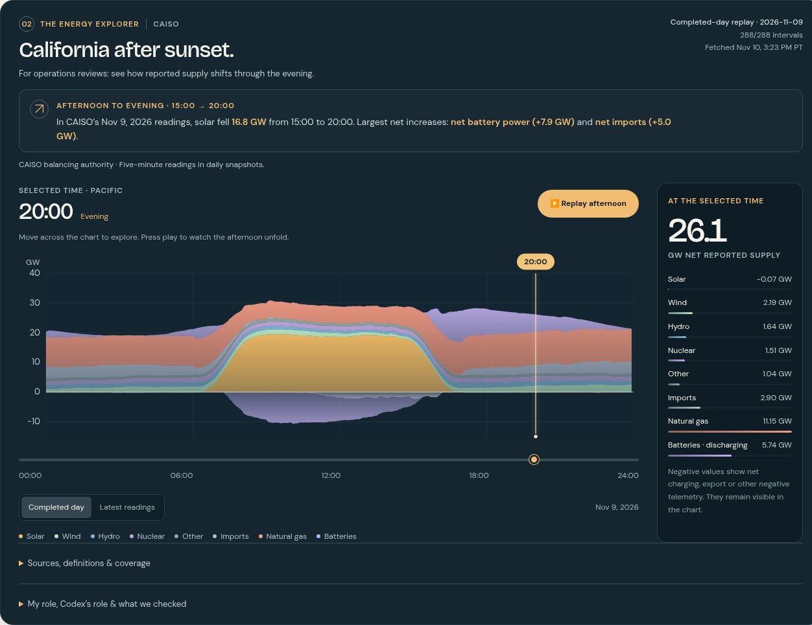

# California Power Mix

**What changes as solar output falls through the afternoon?**

Move through a saved day of CAISO readings to see the reported supply mix, battery charging and discharging, and net imports. The explorer keeps source dates, signed values, and coverage visible so someone can inspect the result and understand its limits.

**[Try the original online demo](https://www.richcouch.com/lab/index.html#power)** · **[Richard's portfolio](https://www.richcouch.com/)** · **[Enterprise analytics work](https://www.richcouch.com/impact/pge-analytics)**

This is a focused, independently runnable extraction of the power view in my Live Data Lab. It is a personal demonstration using public data.

[](https://www.richcouch.com/lab/index.html#power)

*Power view in the original Live Data Lab, showing saved November 9, 2026 readings at 20:00 Pacific. This repository contains a separate, runnable copy with a dated snapshot.*

## My role

I selected the example and asked for an immediate, understandable explanation using real readings. I directed the audience, design, and usability brief. Codex implemented the data collection, signed supply chart, and replay controls, and performed implementation checks.

The work sample shows the brief, the working result, and the decisions that make the result understandable. My professional program delivery and analytics experience is described separately in the linked portfolio case studies.

## Try it in a minute

1. Open the [original online demo](https://www.richcouch.com/lab/index.html#power), or [run this copy locally](#run-locally). The online demo and this saved copy may show different dates.
2. Keep **Completed day** selected and move the time slider from 15:00 toward 20:00. Watch solar, batteries, imports, and natural gas change. The slider also works with keyboard arrow keys.
3. Check the displayed observation date and fetch time. Expand **Sources, definitions & coverage** for the original CSV links, coverage, and missing-data rules.
4. Select **Latest readings** in the online demo, or **Saved latest snapshot** in this copy, to inspect the separately dated current-feed snapshot when available. It contains only readings saved at fetch time and may cover a partial day.

The bundled complete day is **November 9, 2026**, with **288 five-minute intervals**. The optional current-feed snapshot is **November 10, 2026, through 15:15 Pacific**, with 184 intervals. Both were fetched on November 10. This repository has no automatic refresh schedule. Its included data will become historical; the dates remain visible.

For a reproducible example in the bundled day, reported solar changes from 16.726 GW at 15:00 to -0.072 GW at 20:00. Net battery power changes from -2.154 GW to +5.737 GW. Those are source observations, including the small negative solar reading. The comparison shows what changed together; it does not establish causation.

## Run locally

From this repository's root, with Python 3 installed:

```sh
python3 -m http.server 8765 --directory site
```

Open **http://localhost:8765/**. Use the local HTTP server rather than opening the HTML file directly, because the page fetches its JSON snapshot.

The display uses plain HTML, CSS, JavaScript, and SVG. It needs no build process, package installation, login, paid API, runtime AI call, or external font download. The browser reads only the included same-origin JSON unless you follow a source or portfolio link.

## Design decisions

| Decision | Reason |
| --- | --- |
| Start with a complete saved day | A reader can inspect the full afternoon even when the current feed is partial or unavailable. |
| Preserve negative values | Charging, net exports, and other signed telemetry remain visible. Clipping them would change the story. |
| Keep missing observations missing | Gaps are not filled with estimated readings. |
| Separate observation date from fetch time | A recent download does not make its underlying readings current. |
| Convert MW to GW only for display | The source snapshot retains the original numeric scale and component values. |
| Keep the page static | The example is easy to run and does not depend on visitor-time provider access. |

## Refresh deliberately

The refresh script uses Python 3.9+ and the standard library, including an installed IANA time-zone database. It checks up to seven preceding dates for a complete replay, then tries to save a separately dated current feed.

```sh
python3 scripts/fetch_power.py --output site/data/power.json
```

For a fixed historical replay without the current feed:

```sh
python3 scripts/fetch_power.py --as-of 2026-11-10 --skip-latest --output site/data/power.json
```

Source availability is external to this project. If no valid complete day is obtained, the existing file is preserved. An optional current-feed failure can still leave a valid replay, with a warning recorded in the output. The script does not commit, deploy, or install a schedule.

## Source and limits

The source is **[CAISO Today's Outlook](https://www.caiso.com/todays-outlook/supply)**. See [the data notes](docs/DATA.md) for field mapping, coverage, provenance, and interpretation.

- Coverage is the **CAISO balancing authority**, not all California electricity use.
- Readings are five-minute average **power**, not energy consumed over an entire day.
- The displayed total is the algebraic sum of the shown buckets, not a separate demand measurement.
- These are saved observations, not a continuous live feed or a forecast.
- CAISO identifies Today's Outlook as informational and subject to change. It is not a basis for billing or operational planning.
- This project does not calculate renewable shares, carbon emissions, or a causal explanation for changing supply.

## Files

| Path | Purpose |
| --- | --- |
| `site/index.html` | Focused explorer and visible source/context notes |
| `site/app.js` | Signed chart, time selection, replay, and dated-snapshot display |
| `site/styles.css` | Responsive layout with local system fonts |
| `site/data/power.json` | Reproducible source snapshot, coverage, component values, and source hashes |
| `scripts/fetch_power.py` | Bounded retrieval, validation, and atomic replacement of the snapshot |
| `docs/ORIGIN.md` | Extraction and attribution details |

## Attribution

**Directed by Richard Couch. Built with Codex.** This extraction retains the original power renderer and fetcher, with a focused page shell and loading/navigation code. Source-data attribution and links remain in the data and interface.

No open-source license has been selected for this repository. See [NOTICE.md](NOTICE.md) for scope and third-party data attribution.

